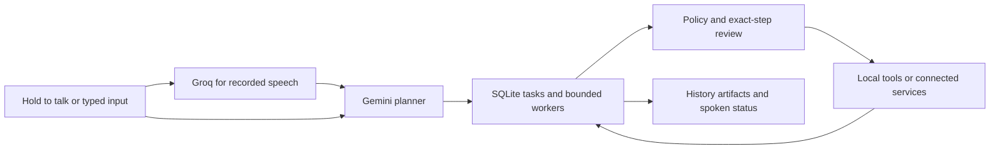

<div align="center">
  
  <h1>Bilal AI</h1>
  <p><strong>A voice agent for your Windows desktop.</strong></p>
  <p>Ask questions, work across apps, and turn spoken requests into actions.</p>
  <p>
    
    
    
  </p>
  <p>
    <a href="#quick-start">Quick start</a> ·
    <a href="#what-bilal-can-do">Capabilities</a> ·
    <a href="#how-it-works">Architecture</a> ·
    <a href="#privacy-and-control">Privacy</a> ·
    <a href="#development">Development</a> ·
    <a href="docs/README.md">Documentation</a>
  </p>
</div>

---

Bilal is an experimental **Windows LLM agent with local tools and a durable task queue**. Hold **left Ctrl + left Shift**, speak, and release to submit. You can give another task while earlier work runs, inspect saved results, and review sensitive steps before execution. Automatic follow-up recording is off.

> **Build status:** This is a capability foundation, not the completed 138-capability product. Read the [current capability status and known blockers](docs/CAPABILITY_STATUS.md) alongside the [full capability specification](docs/CAPABILITY_SPEC.md). Source implementation, automated tests, and physical/live acceptance are separate evidence.

**Wake activation defaults off** in production until a fresh independent acceptance report passes its gates. Use hold-to-talk or typed input meanwhile. Gmail/Notion live account tests remain pending by user choice. Read-only Codex delegation has passed a local live check; Claude's official CLI 2.1.309 is installed locally, but its API-key setup and live authenticated test remain pending. No external agent has write access.

## What Bilal can do

| Capability | Example request | What to expect |
| --- | --- | --- |
| Background tasks | “Summarize this, then prepare a draft.” | Structured planning, up to three workers, persisted task states and results; live multi-command acceptance remains pending. |
| Exact pasted text | Double-click the avatar, paste, then describe the task. | Local literal slots keep payload separate from model-written instructions. |
| Files | “Save this exact text in my allowed project folder.” | Folder-scoped tools, reviewed writes and version snapshots. |
| Owned browser | “Open this allowed website and read its form.” | Playwright-controlled Chrome in a separate Bilal profile; exact domains configured in Settings. |
| Screen questions | “What is on this screen?” | Explicit capture choice and indicator before a one-shot image goes to Gemini; answer only. |
| Read-only delegation | “Ask Codex to analyze this saved result.” | Runs a restricted CLI task and saves its answer in history; no edits. |
| Answer questions | “What's the difference between a website and a web app?” | A conversational answer through Gemini and Windows speech. |
| Work with desktop apps | “Open Notion.” | Discovers registered apps, launches them, and inspects accessible Windows controls. |
| Play music | “Play Blinding Lights by The Weeknd on Spotify.” | Searches Spotify and checks the actual playback result. |
| Research facts or open a search | “What is the Fajr start time tomorrow in Karachi, Pakistan?” | Quiet search/public reading or date-specific prayer calculation; Chrome opens only when explicitly requested. |
| Prepare email | “Draft an email saying our meeting is tomorrow at 3 PM.” | Asks for missing details, creates an unsent Gmail draft, and presents it for review. Requires Gmail setup. |
| Work in Notion | “Find my Bilal AI page.” | Searches and reads shared pages; can create and read back a requested note. Requires Notion setup. |
| Remember preferences | “Remember that my preferred city is Karachi.” | Proposes a memory and saves it locally after you confirm. |
| Control laptop power | “Put my laptop to sleep.” | Requests confirmation for sleep, shutdown, or restart before executing locally. |

These are examples of natural requests, not a list of required command sentences. Available tools and observable app state determine what the agent can complete.

### A conversation that keeps moving

You can dictate an email before providing the recipient:

1. **You:** “Draft an email. Subject: Meeting update. Body: Our meeting is tomorrow at 3 PM.”
2. **Bilal:** Asks for the recipient's address and opens a small input box.
3. **You:** Paste the address and press **Enter**.
4. **Bilal:** Continues with the content you already dictated and prepares the draft.
5. **You:** Review the recipient, subject, and body, then approve or reject sending.

The input box appears for an email address and closes after submission or cancellation. General details such as a city are asked aloud; hold left Ctrl + left Shift (or use wake after acceptance) with the answer to continue the original task. Providing an address does **not** approve sending.

## Quick start

### Requirements

- Windows with Python **3.11**.
- A microphone and speakers or headphones.
- Gemini and Groq API keys with available quota.
- Internet access for reasoning, command transcription, and account services.
- Spotify or Chrome installed when using their respective tools.

Wake verification and desktop actions run locally. The full assistant requires the hosted services above.

### 1. Clone and install

Run in PowerShell:

```powershell
git clone https://github.com/NameerKhan7/BilalAi.git
cd BilalAi
py -3.11 -m venv venv
.\venv\Scripts\python.exe -m pip install -r requirements.txt
```

### 2. Add your API keys

Copy the template once, then edit the local file:

```powershell
Copy-Item .env.example .env
notepad .env
```

```dotenv
GEMINI_API_KEY=your_gemini_key
GROQ_API_KEY=your_groq_key
# Optional: leave blank to use the project's default model.
GEMINI_MODEL=
```

If you already have a `.env`, edit it without replacing it. Keep actual credentials out of Git and chat.

### 3. Optional: prepare wake verification

```powershell
.\venv\Scripts\python.exe .\setup_wake_verifier.py
```

Wake is not required for hold-to-talk. Installing this model does not unlock wake activation: its independent acceptance report is also required.

This downloads a roughly **145 MB** speech model plus supporting files into `models/wake_asr/`. The installer uses a fixed public model revision, verifies the weight checksum, and resumes interrupted downloads. It does not upload audio.

### 4. Start Bilal

```powershell
.\venv\Scripts\python.exe .\main.py
```

Bilal starts **hidden**, with a system tray icon. Hold **left Ctrl + left Shift**, say “Open Spotify,” and release. There is no wake phrase requirement for this recording. Quit an existing tray instance before starting an update.

Use **Tasks, history and settings → Settings** to store provider keys in Windows Credential Manager. Legacy `.env` keys remain supported; the Settings migration action verifies encrypted copies before clearing migrated values from `.env`. Add `ANTHROPIC_API_KEY` there only if you want to use the installed Claude adapter; subscription sign-in alone is not sufficient for its bare mode.

## Everyday controls

| Action | Control |
| --- | --- |
| Hold to talk globally | **left Ctrl + left Shift**; release to submit |
| Change shortcut / toggle mode | **Tasks, history and settings → Settings**, then restart; left Ctrl + left Shift alone is opt-in |
| Stop all work | **Left Ctrl + left Alt + Backspace**, or **Stop all background tasks** |
| Exact pasted input | Double-click the avatar, or **Paste exact text / quick input** |
| Task states, saved answers, approvals | **Tasks, history and settings** |
| Screen question | **Ask about a window / point to ask**, then choose the capture |
| Manual recording / typed request | **Start / finish recording** or **Read reply / type a request** |
| Legacy email / memory / power review | **Pending approvals** |
| Speech output | **Speak replies** |
| Exit | **Quit Bilal** |

Ordinary manual/wake capture ends after four seconds of detected silence, waits up to ten seconds for initial speech, and is bounded at 90 seconds. A new held capture suppresses silence/no-speech stopping while held, with a 600-second chunk bound. Release hides the companion and submits audio; processing/spoken output can continue while hidden. No automatic next command capture starts after a reply.

The global keyboard hook tracks the configured chord, forwards keystrokes, ignores injected keys, and does not record typed text. Other apps can still react to that shortcut. Cancellation is cooperative: it stops later steps but cannot undo completed effects or guarantee an in-flight request stopped immediately.

### The companion

The default interface is a **96 × 120 px** transparent character and orb near the bottom center of the screen. It animates through idle, listening, processing, speaking, success, error, loading, and inactive states. Drag it to reposition it; open the full conversation only when needed.

The artwork is a 2D sprite system animated in Qt. Colors and typography live in [`brand_theme.json`](brand_theme.json); asset provenance is documented in [`assets/character/ASSET_NOTES.md`](assets/character/ASSET_NOTES.md).

## How it works



Assistant commentary, clarification, and spoken replies use English, with brief context-appropriate humor when useful. Explicitly requested non-English document content can retain that language. The agent interprets the goal, chooses a tool, observes its returned result, and decides what to do next. Questions can be answered without desktop actions. Tasks have a **12-round / 180-second** reasoning budget, with bounded tool timeouts and cancellation checks.

Desktop control uses Windows accessibility information. Each generic action invalidates previously observed control IDs, so the agent must inspect again before acting further. Launching an app or opening search results alone does not establish that the whole task succeeded.

| Layer | Technology |
| --- | --- |
| Interface and animation | PySide6 / Qt |
| Wake candidate detection | openWakeWord / ONNX |
| Local phrase verification | Whisper base.en through faster-whisper / CTranslate2 |
| Command transcription | Groq Whisper |
| Reasoning and tool selection | Gemini through `google-genai` |
| Windows app interaction | pywinauto / UI Automation |
| Spoken output | Windows speech through Qt / SAPI |
| Tasks, history, artifacts, preferences and approvals | SQLite / FTS5 |
| Owned browser | Playwright + Chrome, separate persistent profile |
| Explicit screen answers | PySide6 picker/overlay, memory-only image, Gemini vision |
| Read-only delegation | Restricted Codex / Claude subprocess adapters |
| Credential storage | Windows Credential Manager for provider keys; DPAPI for account tokens |

### Wake activation and background audio

Production wake defaults **off** unless `data/wake_acceptance.json` passes all checks: independent evidence, at least 50 positive trials, at least 90% true activation, at least one hour of negatives, fewer than one false activation/hour, and a test timestamp no older than 30 days. Training clips or installing the verifier do not satisfy this acceptance gate. See [testing](docs/testing.md).


The live monitor uses a **0.30 candidate threshold**, while the standalone classifier diagnostic retains **0.80**. Both retain two-frame confirmation; the more permissive live candidate still must pass the local phrase verifier. This is a policy change, not newly trained classifier weights.

An acoustic detection score alone cannot activate the companion. Bilal checks a candidate with the offline phrase verifier, requiring the complete **“Hey Bilal”** phrase and a strict recognition score. The verifier uses wake vocabulary context; that context alone is not sufficient to activate it.

The popup stays hidden during verification, and command audio is buffered locally. A wake-started command whose final transcript lacks the trigger is discarded before agent execution. If verification cannot load or fails, automatic activation is disabled; manual input remains available.

**This is not speaker identification or playback echo cancellation.** Media actually saying “Hey Bilal” can still trigger Bilal. Background-video and real microphone testing remain necessary, and the extra check adds roughly two seconds on the development PC.

## Optional account connections

Bilal needs its **own** account authorization. Connecting an account to Codex does not connect the standalone assistant, and a Gemini API key does not grant Gmail or Notion access.

### Gmail

Enable the Gmail API in your Google project and obtain a **Desktop OAuth client JSON**. Then run:

```powershell
.\venv\Scripts\python.exe .\setup_connections.py gmail --client-json "C:\path\to\desktop-client.json"
```

Complete consent locally. Bilal supports plain-text drafts and an exact recipient/content review before sending. A changed draft needs a new review, and an approval can be used only once. Attachments are not connected. If a send outcome is uncertain, inspect Gmail Sent before retrying.

### Notion

Create a Notion integration with the required permissions and share the intended parent page with it. Then run:

```powershell
.\venv\Scripts\python.exe .\setup_connections.py notion
```

Enter the token at the hidden local prompt. Bilal can access only pages shared with the integration. Choose a real parent page before requesting a new note.

Live account acceptance is still pending. See the [implementation status](docs/MVP_IMPLEMENTATION.md) and [field acceptance guide](docs/FIELD_ACCEPTANCE.md) for the remaining checks.

## Privacy and control

| Data or action | Where it goes |
| --- | --- |
| Wake candidates and phrase verification | Processed locally; candidate verification makes no provider calls. |
| Recorded commands and spoken clarification answers | Sent to Groq after explicit wake/manual/hold capture; automatic follow-up recording is off by default. |
| Requests, relevant observations, and confirmed preferences | Shared with Gemini when used for reasoning. |
| Desktop actions | Executed locally through defined tools. |
| Connected account operations | Sent to the corresponding Gmail or Notion API. |
| Account tokens | Stored locally with encryption tied to the current Windows user. |
| Explicit screen image | Only the chosen scope goes to Gemini; image stays memory-only locally; the answer can persist. |
| Read-only delegated task | Task and selected non-secret artifact go to the chosen CLI/provider. |
| Exact snippets | Local substitution; non-secret added snippets may be saved, secrets stay memory-only. |

Local recordings, transcripts, replies, and task traces can contain private content. They are excluded from Git, along with learned state, account credentials, reviewed wake recordings, and downloaded verifier weights.

Email sending and laptop power actions require a dedicated human confirmation. The agent has no approval tool and cannot operate its own approval windows. Generic controls block sending, publishing, deletion, purchases, authentication, security changes, and power actions. There is no model-generated shell-command executor.

Power confirmations expire after two minutes. Shutdown and restart preserve Windows' save-work handling; the implementation does not force apps closed. While the laptop is asleep, Bilal cannot hear its trigger.

## Start with Windows

Install or update the current user's sign-in shortcut:

```powershell
.\venv\Scripts\python.exe .\startup_windows.py
```

Bilal then starts through `pythonw.exe` without a console window and remains hidden until activated. A single-instance lock prevents duplicate assistant instances. Startup runs **after sign-in**, not before login; keep the project and virtual environment at their installed paths.

Remove automatic startup:

```powershell
.\venv\Scripts\python.exe .\startup_windows.py --remove
```

### Quiet research

Factual questions use quiet Bing RSS search and public webpage reading without opening tabs. Search can be blocked; snippets alone do not verify a changing fact. Research is bounded in code per run: two searches, three page reads, two browser openings, and two prayer lookups, with identical repeats blocked. Prayer lookup independently resolves the confirmed city/country through Nominatim/OpenStreetMap, then requests Aladhan by coordinates, date, and calculation method (default 1, Karachi). It cross-checks returned coordinates/date/method rather than trusting a city-name response. These are calculated prayer starts, not mosque congregation times. No GPS/IP location is inferred; a missing city is asked aloud.

## Current limits and known failure states

- **Full product scope:** all 138 capability IDs are tracked, not completed. External-agent writes, project-only OS read isolation, installer/onboarding, representative resource benchmarks, and dogfooding remain release work.
- **Task recovery:** tasks, steps, history and artifacts persist. Running work becomes interrupted after restart; writes are not blindly replayed. Memory-only literal payloads and screen frames expire, so affected continuations need fresh input.
- **Approvals:** a single-step approval resumes that exact step. A deterministic file/contact/project/schedule plan can batch up to 20 calls under one review; edits invalidate approval and execution stops at the first failed check. Dynamic UI batches and external-agent write plans are excluded.
- **Browser:** owned Chrome DOM tools do not attach to personal tabs. Exact allowed domains must include needed hostnames; blocked navigation/resources, stale elements, and protected controls can stop progress. This is not unrestricted browser automation.
- **Screen/pointer:** explicit one-shot questions are implemented with sensitive-window guards and a 20-question/day limit. Pointer interception is partial pending secure-desktop, exclusive-fullscreen and mixed-DPI acceptance. No autonomous vision-based clicking is supplied.
- **Agents:** local read-only Codex live check passed. Claude 2.1.309 is installed locally but needs `ANTHROPIC_API_KEY` in Settings and live acceptance. Neither adapter can edit files; read-only mode does not establish machine-wide confidentiality isolation.
- **Voice/apps:** physical hotkey, speech, background playback and general app accessibility acceptance remain pending. Wake is gated off until independent evidence passes.
- **Accounts/power:** Gmail/Notion live authorization tests remain pending by choice. Attachments and broad account management are absent. Windows can refuse/delay power requests; accepted is not proof of a completed transition.
- **Protection coverage:** secret detection and sensitive-window names are heuristics, not exhaustive prevention. Audit-chain checking is local integrity evidence, not complete reconstruction of every possible external effect.

The [capability status matrix](docs/CAPABILITY_STATUS.md) records the per-feature assessment and remaining acceptance work. Use the [full spec](docs/CAPABILITY_SPEC.md) for the target, not as a claim that every row already works.

## Development

### Run tests and readiness checks

```powershell
.\venv\Scripts\python.exe -m unittest discover -s tests -q
.\venv\Scripts\python.exe .\check_mvp_readiness.py --tests
```

Automated foundation tests cover durable tasks, literal preservation, policy approvals and existing regressions. The current run and live evidence are recorded in [testing](docs/testing.md) and [capability status](docs/CAPABILITY_STATUS.md); a passing test count is not proof of all 138 acceptance cases. Account and power effects in automated tests are simulated. Physical microphone, hotkey, account and sign-in checks remain separate.

The readiness report is written to the ignored `logs/mvp_readiness.json`. It checks local configuration without account API calls or microphone recording.

### Improve wake recognition

Use **Collect reviewed wake examples** from the tray for guided local recording and playback before labelling. Collect separate sessions with both the full trigger and non-trigger speech. Then evaluate and prepare a candidate:

```powershell
.\venv\Scripts\python.exe .\evaluate_wake_learning.py
.\venv\Scripts\python.exe .\train_reviewed_wake.py --train-candidate
```

Training requires reviewed data from balanced sessions. Missing or changed clips are excluded. Candidates stay separate from the deployed model and need fresh microphone validation before promotion. See [voice calibration](training/VOICE_CALIBRATION.md).

### Preview the interface

```powershell
.\venv\Scripts\python.exe .\main.py --preview-all
```

This renders the eight character states without microphone or API usage. Images are saved in the ignored `ui_preview/` folder.

### New capability foundation

**Tasks** use three workers by default, dependency-aware child tasks and in-app schedules. The app must be running for schedules to fire; it cannot wake an asleep PC. Task Center exposes Tasks, History, Approvals, Audit and Settings.

**Exact input** separates pasted payload from instructions. Quick Input sends opaque descriptors/tokens to planning, and the local executor substitutes original text. Non-secret added snippets can be saved locally; secret slots are memory-only. Closing the panel clears its vault while already queued tasks keep their own copies. Secret detection is heuristic. Provider keys belong in Settings, not an instruction.

**File policy** starts with no allowed folders. Add a narrowly chosen folder in Settings. Writes, moves, recycling and restores need exact-step review; overwrites keep version snapshots. Versions are Windows-user-encrypted locally. New copy operations are lower-risk and do not use the same approval gate as overwrites. Dry run shows planned tool calls without executing their effects.

**Owned browser** uses a separate profile at `data/browser-profile/`; configure exact allowed hostnames, without wildcards, in Settings. It offers observed DOM reading/filling/clicking with stale-element checks. Authentication, submission and destructive controls remain blocked.

**Screen questions** require an explicit capture choice and visible indicator. Only the selected window/monitor/region is sent to Gemini. Image frames stay in memory; derived answers can persist as artifacts. The answer model has no action tools. Sensitive-title guards and pointer interception are implemented foundations, with physical edge-case acceptance pending.

### Source map

| Files | Responsibility |
| --- | --- |
| `task_runtime.py`, `task_engine.py`, `task_store.py`, `task_center.py` | Durable queue, bounded execution, history, artifacts, task review and Settings |
| `tool_policy.py`, `capability_tools.py`, `file_tools.py`, `literal_slots.py`, `quick_input.py` | Policy, scoped files, exact pasted payloads and reviewed continuations |
| `dom_bridge.py`, `dom_worker.py`, `screen_awareness.py`, `media_controls.py` | Owned browser, explicit screen questions, observed playback and volume |
| `delegation.py`, `provider_keys.py`, `wake_acceptance.py` | Restricted CLI adapters, provider credentials and wake acceptance gate |
| `main.py`, `ui_controller.py`, `contextual_input.py`, `conversation.py`, `hold_to_talk.py` | Companion UI, conversation presence, global hold-to-talk, request lifecycle, and missing-detail popup |
| `agent_core.py`, `agent_tools.py`, `request_router.py` | Model reasoning, tool declarations, and dispatch |
| `wake_service.py`, `wake_verifier.py`, `wakeword_gate.py` | Wake monitoring, local phrase check, and temporal gate |
| `audio_capture.py`, `stt_client.py`, `voice_cancel.py` | Recording, command transcription, and interruption |
| `desktop_worker.py`, `app_tools.py` | Windows observation and app control |
| `spotify_tools.py`, `spotify_worker.py` | Spotify search, playback, and verification |
| `browser_tools.py`, `web_reader.py`, `research_tools.py` | Explicit browser opening, quiet search, public reading, prayer calculations, and research budgets |
| `business_tools.py`, `power_tools.py` | Account workflows and confirmed power requests |
| `memory.py`, `secret_store.py` | Persistent preferences, approvals, and encrypted credentials |
| `startup_windows.py`, `launch_bilal.pyw` | Sign-in startup and silent launch |

## Troubleshooting

| Problem | First check |
| --- | --- |
| No window appears at launch | Normal: Bilal starts hidden. Look for its tray icon. |
| “Bilal is already running” | Use the existing tray instance; quit it before restarting an update. |
| Wake activation is unavailable | Expected until independent acceptance passes; use hold-to-talk. The offline model is also needed after acceptance. |
| A video triggers the companion | Check whether it contained the full phrase; mark false activations from the tray and follow the background-playback test guide. |
| Recording ends while thinking | Ordinary capture ends after four seconds of silence. Use left Ctrl + left Shift hold-to-talk for longer thinking pauses, releasing to submit. |
| No audible reply | Enable **Speak replies**, check the default output device, and check installed Windows voices. |
| Gmail or Notion is unavailable | Complete Bilal's standalone account setup and page permissions. |
| A task fails or claims the wrong outcome | Inspect its state, steps, error and artifacts in **Tasks, history and settings**; redact private data before sharing. |

## Project documentation

Start with the [documentation hub](docs/README.md) for the user guide, feature reference, architecture, code walkthrough, configuration, testing, and troubleshooting. For code changes, follow the [contribution and documentation workflow](CONTRIBUTING.md).

- [Current capability implementation and acceptance status](docs/CAPABILITY_STATUS.md)
- [Full 138-capability target specification](docs/CAPABILITY_SPEC.md)
- [Historical MVP implementation](docs/MVP_IMPLEMENTATION.md)
- [Physical voice and account test guide](docs/FIELD_ACCEPTANCE.md)
- [Wake calibration](training/VOICE_CALIBRATION.md)
- [Character asset notes](assets/character/ASSET_NOTES.md)
- [Pre-change MVP baseline](docs/MVP_BASELINE.md)

When reporting an issue, include the Windows/app version, expected behavior, and a redacted transcript or relevant trace excerpt. Keep credentials and private recordings out of public issues.
