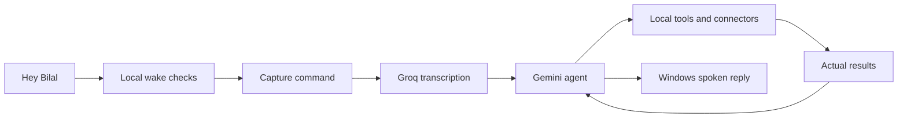

<div align="center">
  
  <h1>Bilal AI</h1>
  <p><strong>A voice agent for your Windows desktop.</strong></p>
  <p>Ask questions, work across apps, and turn spoken requests into actions.</p>
  <p>
    
    
    
  </p>
  <p>
    <a href="#quick-start">Quick start</a> ·
    <a href="#what-bilal-can-do">Capabilities</a> ·
    <a href="#how-it-works">Architecture</a> ·
    <a href="#privacy-and-control">Privacy</a> ·
    <a href="#development">Development</a> ·
    <a href="docs/README.md">Documentation</a>
  </p>
</div>

---

Bilal combines voice input, an LLM agent, and tools that operate on your PC. Say **“Hey Bilal”** to bring up a small animated companion, speak your request, and hear the reply. The companion hides after the reply. Automatic follow-up listening is disabled by default; use the wake phrase, hold-to-talk, or manual input for each new turn.

When something is missing, Bilal asks. When an email is ready to send or a power action is requested, it waits for your confirmation.

> **Project status:** Experimental and under active development. Desktop control depends on each app's accessibility support. Gmail and Notion workflows are implemented, but live account acceptance remains pending. Wake detection still needs testing in everyday conditions.

## What Bilal can do

| Capability | Example request | What to expect |
| --- | --- | --- |
| Answer questions | “What's the difference between a website and a web app?” | A conversational answer through Gemini and Windows speech. |
| Work with desktop apps | “Open Notion.” | Discovers registered apps, launches them, and inspects accessible Windows controls. |
| Play music | “Play Blinding Lights by The Weeknd on Spotify.” | Searches Spotify and checks the actual playback result. |
| Research facts or open a search | “What is the Fajr start time tomorrow in Karachi, Pakistan?” | Quiet search/public reading or date-specific prayer calculation; Chrome opens only when explicitly requested. |
| Prepare email | “Draft an email saying our meeting is tomorrow at 3 PM.” | Asks for missing details, creates an unsent Gmail draft, and presents it for review. Requires Gmail setup. |
| Work in Notion | “Find my Bilal AI page.” | Searches and reads shared pages; can create and read back a requested note. Requires Notion setup. |
| Remember preferences | “Remember that my preferred city is Karachi.” | Proposes a memory and saves it locally after you confirm. |
| Control laptop power | “Put my laptop to sleep.” | Requests confirmation for sleep, shutdown, or restart before executing locally. |

These are examples of natural requests, not a list of required command sentences. Available tools and observable app state determine what the agent can complete.

### A conversation that keeps moving

You can dictate an email before providing the recipient:

1. **You:** “Draft an email. Subject: Meeting update. Body: Our meeting is tomorrow at 3 PM.”
2. **Bilal:** Asks for the recipient's address and opens a small input box.
3. **You:** Paste the address and press **Enter**.
4. **Bilal:** Continues with the content you already dictated and prepares the draft.
5. **You:** Review the recipient, subject, and body, then approve or reject sending.

The input box appears for an email address and closes after submission or cancellation. General details such as a city are asked aloud; hold left Ctrl + left Shift or say “Hey Bilal” with the answer to continue the original task. Providing an address does **not** approve sending.

## Quick start

### Requirements

- Windows with Python **3.11**.
- A microphone and speakers or headphones.
- Gemini and Groq API keys with available quota.
- Internet access for reasoning, command transcription, and account services.
- Spotify or Chrome installed when using their respective tools.

Wake verification and desktop actions run locally. The full assistant requires the hosted services above.

### 1. Clone and install

Run in PowerShell:

```powershell
git clone https://github.com/NameerKhan7/BilalAi.git
cd BilalAi
py -3.11 -m venv venv
.\venv\Scripts\python.exe -m pip install -r requirements.txt
```

### 2. Add your API keys

Copy the template once, then edit the local file:

```powershell
Copy-Item .env.example .env
notepad .env
```

```dotenv
GEMINI_API_KEY=your_gemini_key
GROQ_API_KEY=your_groq_key
# Optional: leave blank to use the project's default model.
GEMINI_MODEL=
```

If you already have a `.env`, edit it without replacing it. Keep actual credentials out of Git and chat.

### 3. Install the offline wake verifier

```powershell
.\venv\Scripts\python.exe .\setup_wake_verifier.py
```

This downloads a roughly **145 MB** speech model plus supporting files into `models/wake_asr/`. The installer uses a fixed public model revision, verifies the weight checksum, and resumes interrupted downloads. It does not upload audio.

### 4. Start Bilal

```powershell
.\venv\Scripts\python.exe .\main.py
```

Bilal starts **hidden**, with a system tray icon and local wake monitoring. Say:

> Hey Bilal, open Spotify.

Speak naturally in one utterance; the wake check buffers audio while it verifies the trigger. You can also start recording or type a request from the tray. Quit an existing instance from the tray before starting an updated version.

## Everyday controls

| Action | Control |
| --- | --- |
| Hold to talk globally | Hold **left Ctrl + left Shift**, speak, then release either key to submit the recording. |
| Start or finish recording | Click the companion, or use the tray's recording action. |
| Type a request or read a reply | Open **Read reply / type a request** from the tray. |
| Provide a missing detail | Type or paste into the temporary input box; press **Enter** or **Continue**. |
| Cancel pending work | Say “never mind” while processing, or use **Cancel request** / **Escape** in Bilal. |
| Enable or disable activation | Toggle **Listen for Hey Bilal** in the tray. |
| Enable or disable speech | Toggle **Speak replies** in the tray. |
| Review waiting actions | Open **Pending approvals** in the tray. |
| Exit the assistant | Choose **Quit Bilal** in the tray. |

Ordinary wake/manual capture allows up to **90 seconds**, waits up to **10 seconds** for speech to start, and ends after **4 seconds of silence** following detected speech. A new hold-to-talk capture suppresses silence/no-speech stopping while the keys remain held; release submits it, with a **600-second chunk bound**. Processing a bounded chunk does not hide the companion while the keys are held.

Automatic follow-up capture is disabled by default. Releasing hold-to-talk hides the companion immediately and sends the captured request for background processing; spoken output can continue while it stays hidden. It does not start another command recording after the answer. A busy or speaking avatar ignores clicks.

The global shortcut polls only the two left modifier states; it does not log typing or consume keys from other apps. General clarification questions are spoken and answered with hold-to-talk or a verified “Hey Bilal” turn; an email address still uses a paste box. Cancellation stops later steps and cannot undo completed actions.

### The companion

The default interface is a **96 × 120 px** transparent character and orb near the bottom center of the screen. It animates through idle, listening, processing, speaking, success, error, loading, and inactive states. Drag it to reposition it; open the full conversation only when needed.

The artwork is a 2D sprite system animated in Qt. Colors and typography live in [`brand_theme.json`](brand_theme.json); asset provenance is documented in [`assets/character/ASSET_NOTES.md`](assets/character/ASSET_NOTES.md).

## How it works



Assistant commentary, clarification, and spoken replies use English, with brief context-appropriate humor when useful. Explicitly requested non-English document content can retain that language. The agent interprets the goal, chooses a tool, observes its returned result, and decides what to do next. Questions can be answered without desktop actions. Tasks have a **12-round / 180-second** reasoning budget, with bounded tool timeouts and cancellation checks.

Desktop control uses Windows accessibility information. Each generic action invalidates previously observed control IDs, so the agent must inspect again before acting further. Launching an app or opening search results alone does not establish that the whole task succeeded.

| Layer | Technology |
| --- | --- |
| Interface and animation | PySide6 / Qt |
| Wake candidate detection | openWakeWord / ONNX |
| Local phrase verification | Whisper base.en through faster-whisper / CTranslate2 |
| Command transcription | Groq Whisper |
| Reasoning and tool selection | Gemini through `google-genai` |
| Windows app interaction | pywinauto / UI Automation |
| Spoken output | Windows speech through Qt / SAPI |
| Preferences and approvals | SQLite |
| Account credential storage | Windows DPAPI |

### Wake activation and background audio

The live monitor uses a **0.30 candidate threshold**, while the standalone classifier diagnostic retains **0.80**. Both retain two-frame confirmation; the more permissive live candidate still must pass the local phrase verifier. This is a policy change, not newly trained classifier weights.

An acoustic detection score alone cannot activate the companion. Bilal checks a candidate with the offline phrase verifier, requiring the complete **“Hey Bilal”** phrase and a strict recognition score. The verifier uses wake vocabulary context; that context alone is not sufficient to activate it.

The popup stays hidden during verification, and command audio is buffered locally. A wake-started command whose final transcript lacks the trigger is discarded before agent execution. If verification cannot load or fails, automatic activation is disabled; manual input remains available.

**This is not speaker identification or playback echo cancellation.** Media actually saying “Hey Bilal” can still trigger Bilal. Background-video and real microphone testing remain necessary, and the extra check adds roughly two seconds on the development PC.

## Optional account connections

Bilal needs its **own** account authorization. Connecting an account to Codex does not connect the standalone assistant, and a Gemini API key does not grant Gmail or Notion access.

### Gmail

Enable the Gmail API in your Google project and obtain a **Desktop OAuth client JSON**. Then run:

```powershell
.\venv\Scripts\python.exe .\setup_connections.py gmail --client-json "C:\path\to\desktop-client.json"
```

Complete consent locally. Bilal supports plain-text drafts and an exact recipient/content review before sending. A changed draft needs a new review, and an approval can be used only once. Attachments are not connected. If a send outcome is uncertain, inspect Gmail Sent before retrying.

### Notion

Create a Notion integration with the required permissions and share the intended parent page with it. Then run:

```powershell
.\venv\Scripts\python.exe .\setup_connections.py notion
```

Enter the token at the hidden local prompt. Bilal can access only pages shared with the integration. Choose a real parent page before requesting a new note.

Live account acceptance is still pending. See the [implementation status](docs/MVP_IMPLEMENTATION.md) and [field acceptance guide](docs/FIELD_ACCEPTANCE.md) for the remaining checks.

## Privacy and control

| Data or action | Where it goes |
| --- | --- |
| Wake candidates and phrase verification | Processed locally; candidate verification makes no provider calls. |
| Recorded commands and spoken clarification answers | Sent to Groq after explicit wake/manual/hold capture; automatic follow-up recording is off by default. |
| Requests, relevant observations, and confirmed preferences | Shared with Gemini when used for reasoning. |
| Desktop actions | Executed locally through defined tools. |
| Connected account operations | Sent to the corresponding Gmail or Notion API. |
| Account tokens | Stored locally with encryption tied to the current Windows user. |

Local recordings, transcripts, replies, and task traces can contain private content. They are excluded from Git, along with learned state, account credentials, reviewed wake recordings, and downloaded verifier weights.

Email sending and laptop power actions require a dedicated human confirmation. The agent has no approval tool and cannot operate its own approval windows. Generic controls block sending, publishing, deletion, purchases, authentication, security changes, and power actions. There is no model-generated shell-command executor.

Power confirmations expire after two minutes. Shutdown and restart preserve Windows' save-work handling; the implementation does not force apps closed. While the laptop is asleep, Bilal cannot hear its trigger.

## Start with Windows

Install or update the current user's sign-in shortcut:

```powershell
.\venv\Scripts\python.exe .\startup_windows.py
```

Bilal then starts through `pythonw.exe` without a console window and remains hidden until activated. A single-instance lock prevents duplicate assistant instances. Startup runs **after sign-in**, not before login; keep the project and virtual environment at their installed paths.

Remove automatic startup:

```powershell
.\venv\Scripts\python.exe .\startup_windows.py --remove
```

### Quiet research

Factual questions use quiet Bing RSS search and public webpage reading without opening tabs. Search can be blocked; snippets alone do not verify a changing fact. Research is bounded in code per run: two searches, three page reads, two browser openings, and two prayer lookups, with identical repeats blocked. Prayer lookup independently resolves the confirmed city/country through Nominatim/OpenStreetMap, then requests Aladhan by coordinates, date, and calculation method (default 1, Karachi). It cross-checks returned coordinates/date/method rather than trusting a city-name response. These are calculated prayer starts, not mosque congregation times. No GPS/IP location is inferred; a missing city is asked aloud.

## Current limits

- **App coverage:** discovering an installed app does not guarantee its interface can be automated. Canvas-only or inaccessible controls can block a task.
- **Browser control:** public webpage reading and accessible controls are available; general browser DOM automation and screenshot-based reasoning are not implemented.
- **Wake accuracy:** the classifier remains experimental. The phrase gate reduces false activation, but fresh voice and background-playback acceptance is still needed.
- **Voice interruption:** offline cancellation uses Windows' English recognizer. Accent, distance, music, and noise can affect recognition.
- **Account workflows:** Gmail and Notion need separate setup and live validation. Gmail attachment sending is unavailable.
- **Power actions:** Windows permissions, open apps, and hardware support can prevent a request. Accepting a request is not proof the machine completed it.
- **Learning:** preferences need confirmation, and wake labels need review. Candidate training does not automatically replace the deployed model.

## Development

### Run tests and readiness checks

```powershell
.\venv\Scripts\python.exe -m unittest discover -s tests -q
.\venv\Scripts\python.exe .\check_mvp_readiness.py --tests
```

**Validation snapshot — 23 October 2026:** 154 automated tests passed. Coverage includes the agent loop, stale controls, recording, transcription, wake gating, contextual input, approvals, cancellation, media verification, shutdown cleanup, and mocked power actions. Account and power effects in these tests are simulated; passing them does not establish live account delivery or complete physical voice acceptance.

The readiness report is written to the ignored `logs/mvp_readiness.json`. It checks local configuration without account API calls or microphone recording.

### Improve wake recognition

Use **Collect reviewed wake examples** from the tray for guided local recording and playback before labelling. Collect separate sessions with both the full trigger and non-trigger speech. Then evaluate and prepare a candidate:

```powershell
.\venv\Scripts\python.exe .\evaluate_wake_learning.py
.\venv\Scripts\python.exe .\train_reviewed_wake.py --train-candidate
```

Training requires reviewed data from balanced sessions. Missing or changed clips are excluded. Candidates stay separate from the deployed model and need fresh microphone validation before promotion. See [voice calibration](training/VOICE_CALIBRATION.md).

### Preview the interface

```powershell
.\venv\Scripts\python.exe .\main.py --preview-all
```

This renders the eight character states without microphone or API usage. Images are saved in the ignored `ui_preview/` folder.

### Source map

| Files | Responsibility |
| --- | --- |
| `main.py`, `ui_controller.py`, `contextual_input.py`, `conversation.py`, `hold_to_talk.py` | Companion UI, conversation presence, global hold-to-talk, request lifecycle, and missing-detail popup |
| `agent_core.py`, `agent_tools.py`, `request_router.py` | Model reasoning, tool declarations, and dispatch |
| `wake_service.py`, `wake_verifier.py`, `wakeword_gate.py` | Wake monitoring, local phrase check, and temporal gate |
| `audio_capture.py`, `stt_client.py`, `voice_cancel.py` | Recording, command transcription, and interruption |
| `desktop_worker.py`, `app_tools.py` | Windows observation and app control |
| `spotify_tools.py`, `spotify_worker.py` | Spotify search, playback, and verification |
| `browser_tools.py`, `web_reader.py`, `research_tools.py` | Explicit browser opening, quiet search, public reading, prayer calculations, and research budgets |
| `business_tools.py`, `power_tools.py` | Account workflows and confirmed power requests |
| `memory.py`, `secret_store.py` | Persistent preferences, approvals, and encrypted credentials |
| `startup_windows.py`, `launch_bilal.pyw` | Sign-in startup and silent launch |

## Troubleshooting

| Problem | First check |
| --- | --- |
| No window appears at launch | Normal: Bilal starts hidden. Look for its tray icon. |
| “Bilal is already running” | Use the existing tray instance; quit it before restarting an update. |
| Wake activation is unavailable | Run `setup_wake_verifier.py`, restart, and inspect `logs/ui_startup.json`. |
| A video triggers the companion | Check whether it contained the full phrase; mark false activations from the tray and follow the background-playback test guide. |
| Recording ends while thinking | Ordinary capture ends after four seconds of silence. Use left Ctrl + left Shift hold-to-talk for longer thinking pauses, releasing to submit. |
| No audible reply | Enable **Speak replies**, check the default output device, and check installed Windows voices. |
| Gmail or Notion is unavailable | Complete Bilal's standalone account setup and page permissions. |
| A task fails or claims the wrong outcome | Inspect the private `logs/agent_latest.json` trace and saved transcript. |

## Project documentation

Start with the [documentation hub](docs/README.md) for the user guide, feature reference, architecture, code walkthrough, configuration, testing, and troubleshooting. For code changes, follow the [contribution and documentation workflow](CONTRIBUTING.md).

- [Implementation and acceptance status](docs/MVP_IMPLEMENTATION.md)
- [Physical voice and account test guide](docs/FIELD_ACCEPTANCE.md)
- [Wake calibration](training/VOICE_CALIBRATION.md)
- [Character asset notes](assets/character/ASSET_NOTES.md)
- [Pre-change MVP baseline](docs/MVP_BASELINE.md)

When reporting an issue, include the Windows/app version, expected behavior, and a redacted transcript or relevant trace excerpt. Keep credentials and private recordings out of public issues.
