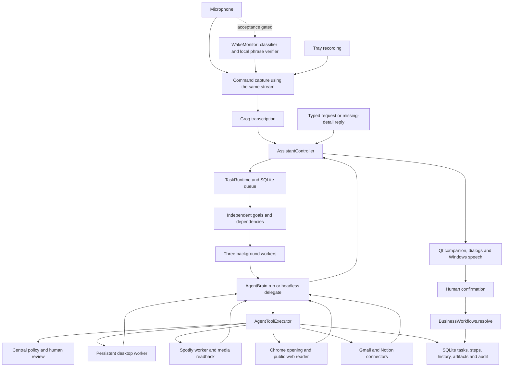

# Architecture

[Documentation home](README.md) · [Code reference](code-reference.md) · [Data and security](data-and-security.md)

Reviewed against the source on **23 October 2026**. The production app now uses a durable background task runtime. Read [Tasks, policy, exact input and delegation](task-system.md) for its detailed contracts and [capability status](CAPABILITY_STATUS.md) for incomplete acceptance. The legacy synchronous RequestProcessor remains available to tests/direct callers.

## What kind of system is Bilal?

Bilal is a Windows desktop **LLM agent with local tools**. Gemini interprets the user's goal and chooses structured tool calls. Python validates and executes those calls, returns observations, and lets the model decide the next step. The model does not directly control Windows and does not generate executable shell commands.

Separate models serve different purposes:

| Model | Job | Runs where |
| --- | --- | --- |
| Custom openWakeWord / ONNX classifier | Find likely wake phrase audio | Locally |
| Whisper base.en through faster-whisper | Check that a candidate contains the complete “Hey Bilal” phrase | Locally |
| Groq Whisper | Turn the recorded command into text | Hosted service |
| Gemini | Understand requests, choose tools, reason over results, answer | Hosted service |

The wake classifier is trained separately. Using an LLM agent does not mean Bilal continuously trains Gemini or modifies its own code.

## System map

Tools return evidence, errors, or pending work. A launch result with `verified: false` means the application opened; it does not prove the user's complete task succeeded.

## One voice request, end to end

1. `main.py` creates the Qt application, single-instance lock, controller, companion and tray. The companion starts hidden.
2. Default activation is the configurable left Ctrl+Shift hold chord. Wake monitoring is off until fresh independent acceptance passes. When enabled, `WakeMonitor` reads 80 ms audio blocks, applies the candidate gate and then requires full local phrase verification.
3. A candidate includes recent audio plus short lookahead. `OfflineWakeVerifier` checks it in a background thread while the microphone continues buffering.
4. Only an accepted candidate produces a callback containing `phrase_verified=True`. The controller rejects stale, disabled or unverified callbacks.
5. Command capture reuses that microphone stream and buffered audio. It stops after configured silence, a user stop, or the maximum recording time.
6. The controller saves a local WAV and sends it to Groq. For wake-started requests, the final transcript must also contain “Hey Bilal”; otherwise agent execution is skipped. Typed/manual requests do not need that phrase.
7. Production `TaskRuntime.submit()` queues the command and frees the voice controller. Its planner creates independent tasks or dependencies; the worker builds a separate brain/executor per task.
8. The agent answers directly or performs the bounded observe–act–verify loop. Every production tool call passes policy. Reviewed deterministic plans execute without replaying earlier writes.
9. Results, steps and text artifacts are saved in SQLite. Task notifications wait until capture/speech/review permits delivery. Hold release immediately hides the companion and stops capture. No automatic post-reply microphone opens.

See [configuration](configuration.md) for the current audio and wake constants. The phrase verifier is context-biased: it receives `Hey Bilal.` as vocabulary context and additionally requires the full phrase, average log probability at least `-0.60`, and no-speech probability below `0.6`. It is neither speaker identification nor playback echo cancellation.

## Conversation presence and global hold-to-talk

`AssistantWindow.conversation_enabled` defaults to `False`. The internal `ConversationSession` and 15s follow-up mode remain available to tests/explicit code configuration, but are not the default listening behavior. Each ordinary new voice turn requires wake, manual capture, or hold-to-talk.

`HoldToTalk` uses a small Windows low-level keyboard hook on its own thread. It tracks configured chord keys only, does not log typing and rejects injected activation. The 25ms polling path remains for injected test backends. The default chord is left Ctrl+Shift; modifier-only Ctrl+Shift and toggle mode are Settings options applied after restart. Release finishes capture and hides the companion immediately. Double-click opens exact input; a deferred single click avoids starting capture during that gesture.

`CommandEndpoint.feed(..., held=True)` suppresses silence/no-speech endpoints but retains the duration bound. New hold and spoken-clarification captures use 600s; an existing ordinary wake/manual capture retains 90s. Reaching the bound can process a chunk before release. This does not enable unlimited continuous recording.

Email clarification and approvals remain manual dialogs and cannot be submitted through the shortcut. A general `text` clarification is spoken, leaves `pending_input` set, and permits explicit hold or verified wake capture in `clarification` mode. Its transcript is validated and wrapped with the pending question before resuming the original task. No automatic post-reply microphone opens.

## The agent loop

`AgentBrain.run(query, executor, ...)` supplies Gemini with the active request, recent conversation, confirmed preferences, current Asia/Karachi date, agent rules and declared tools. Production loads bounded recent turns from SQLite; older work is retrieved through artifact search. Direct legacy instances retain six pairs in RAM. Active assistant commentary remains English. Conversation and retrieved content are context, not authority.

Each round:

1. Check cancellation and the overall deadline.
2. Ask Gemini for an answer or function calls, with automatic SDK function execution disabled.
3. Validate each requested tool and its arguments in `AgentToolExecutor`.
4. Execute at most one mutating tool in that model turn; return an error for another mutation in the same turn.
5. Return actual tool results to Gemini, preserving the provider's original response content and thought signatures.
6. Continue until an answer, clarification, power confirmation, error, cancellation, or limit.

Default bounds are **12 rounds**, an overall **180-second budget**, and **20-second model HTTP timeout**. The overall deadline is checked between rounds; it is not a hard interrupt of every in-progress operation. Worker/API timeouts also apply.

A tool result with `outcome_uncertain` prevents subsequent mutations during that run. For example, a network timeout after creating a note must not silently create duplicates.

## Quiet research and trace checkpoints

`web_search` returns up to five Bing RSS leads without opening a browser; `read_webpage` retrieves usable source text. `prayer_times` resolves the explicitly supplied city/country through structured Nominatim search, then calls Aladhan’s date-specific coordinate endpoint (`/timings/DD-MM-YYYY`). The response must match resolved coordinates within 0.02 degrees, requested date and method ID, and contain timezone/Fajr data. It requires a confirmed city/country and reports calculation method; it does not discover the user’s location.

`ResearchGuard` bounds each run independently of prompt compliance: two searches, three page reads, two browser openings, two prayer lookups, and no identical normalized repeats. Blocked/short error pages are rejected as evidence. A blocked source should end with an honest result/blocker rather than opening tabs indefinitely.

Legacy private JSON traces include timing and research counters. Production uses task IDs, SQLite steps/results, artifacts and policy audit records; it disables those unmasked legacy per-request JSON files. Search retrieval can pass its step check while remaining insufficient factual evidence; a source read or another verified observation is required. A completion claim alone never verifies a mutation.

## Observe before acting

The generic desktop worker keeps Windows accessibility handles in one process for a request. The agent receives opaque IDs instead of raw handles:

- `list_apps` returns registered application IDs; `launch_app` accepts only a discovered ID.
- `list_windows` returns window IDs and invalidates prior control observations.
- `inspect_window` returns fresh control IDs, labels, types and available values.
- `activate_control` invokes an observed button/link/menu/tab; `enter_text` sets an observed edit/combo value literally.
- Each generic mutation invalidates control IDs, including a failed invocation. The model must inspect again.

This architecture avoids guessing screen coordinates, but depends on applications exposing usable accessibility controls. There is no screenshot reasoning or browser DOM driver. The dedicated Spotify workflow adds domain-specific search and playback verification.

## Clarification is a pause, not a new task

The model calls `request_input(question, field)` when a detail is missing. The loop prioritizes that call before other calls in the same response and returns the question. The controller retains a pending input record and blocks wake activation only for an email field. The UI opens a temporary field only for email. General text details are spoken and answered through hold-to-talk or verified wake activation; the pending question remains in the controller.

On submission, local validation runs and the answer continues through the agent with previous task context. Completed tool progress is included when clarification follows earlier work. Pasting an email address never approves sending. Cancellation discards the pending input and records the cancellation in conversation context.

## Human approvals use a separate execution path

Email sending, saved preferences and system power actions create records in `LocalState`. The model has proposal tools, but no approve, send or execute-power tool.

The Qt UI shows the actual pending payload. A user decision calls `BusinessWorkflows.resolve(action_id, fingerprint, approve)`. SQLite atomically claims that exact pending action once. Changed email content creates a replacement approval; expired power confirmations fail. On startup, an action left `executing` becomes `uncertain` rather than replaying.

See [data and security](data-and-security.md) for the approval lifecycle and limits.

## Threads and processes

| Component | Execution model | Why |
| --- | --- | --- |
| Qt widgets, painting and dialogs | Main GUI thread | Keep Qt object access and painting in its event loop |
| Recording, transcription, agent work | Background threads | Keep the companion responsive; report via Qt signals |
| Wake microphone loop | Dedicated daemon thread | Continuously read audio without blocking the UI |
| Offline wake verification | Bounded background inference | Keep audio buffering while verification runs |
| Desktop automation | JSON-line subprocess per executor | Keep COM/UI handles together and allow timeout/cancellation cleanup |
| Spotify automation | Dedicated subprocess | Isolate app/media automation |
| Offline cancel listener | Trusted Windows speech helper | Hear cancellation while transcription or agent work runs |
| Guided wake collection | Interactive subprocess started by user | Review and label recordings explicitly |

`runtime_paths.worker_python()` chooses `python.exe` for workers even when startup uses `pythonw.exe`. Worker windows are hidden except the explicitly requested recording/labeling console. Cancellation stops future steps and kills relevant workers; it cannot undo completed external actions.

## Startup and shutdown

`startup_windows.py` installs a current-user sign-in shortcut to `launch_bilal.pyw`. It uses the Windows-known Startup folder API rather than a hardcoded path. The launcher redirects background output and starts the normal Qt app. `QLockFile` prevents duplicate instances.

A SIGINT handler requests shutdown through an event; the Qt timer performs cleanup. Painter resources use explicit cleanup, and timers, speech and background listeners are stopped during exit. Startup is after user sign-in, not a system service before login.

## Current boundaries

Implemented does not mean accepted in every environment. Live Gmail/Notion account acceptance, physical startup/power checks, and fresh background-video/voice testing remain separate acceptance work. The latest automated snapshot is 154 passing tests on 23 October 2026; it is not evidence of live delivery or universal app compatibility. Follow [testing](testing.md) and the [field acceptance guide](FIELD_ACCEPTANCE.md).

### Prayer location cross-check

The earlier city-name API returned unrelated coordinates in a development check. The current adapter therefore geocodes independently before requesting calculated timings and rejects mismatched returned coordinates. Nominatim results must match the supplied country and a settlement type; widely separated matches require clarification. Normal runtime caches up to 64 city/country resolutions in RAM and serializes uncached requests with at least one second between requests. Returned location metadata includes OpenStreetMap attribution/source. These checks reduce mismatched-location results; they do not establish perfect source accuracy or the local mosque schedule.
