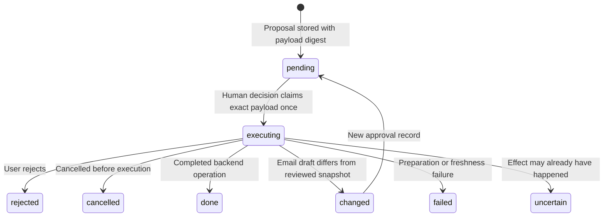

# Data, privacy and execution boundaries

[Documentation home](README.md) · [Architecture](architecture.md) · [Configuration](configuration.md)

Reviewed **22 October 2026**. These are implemented controls and practical limits, not a security audit or guarantee against every malicious application/page.

## What leaves the computer?

| Data | Destination | When |
| --- | --- | --- |
| Wake microphone buffers and candidate phrase verification | Local processing | While wake monitoring is enabled; verifier makes no provider request |
| Full recorded command WAV | Groq | After manual recording or accepted wake activation and speech capture |
| User request, recent conversation, confirmed preferences and relevant tool results | Gemini | During reasoning; observations can contain app, webpage or account text |
| Gmail draft/send data | Gmail API | Only with Bilal's standalone Gmail connection |
| Notion page queries/content/new note | Notion API | Only with Bilal's standalone integration and shared page access |
| Public webpage URL/request | Target web server | During `read_webpage`; without browser login cookies |
| Search text/URLs | Chrome and target websites | When a browser tool opens them |

The second trigger check happens after Groq transcription. A rejected final transcript is prevented from reaching the agent, but that command audio has already been uploaded to Groq. Rejected **local verifier candidates** do not get uploaded by the wake verifier.

There is no fully offline reasoning fallback. Provider retention/billing rules are separate from this application's local controls.

## Local files and retention

| Location | Contents | Protection and lifecycle |
| --- | --- | --- |
| `.env` | Gemini/Groq API configuration | Plain local file; Git-ignored; do not share |
| `.secrets/gmail.bin`, `.secrets/notion.bin` | Account authorization data | DPAPI encrypted for the current Windows user; Git-ignored |
| `data/assistant.sqlite3` | Confirmed preferences and approval records | Local SQLite, not encrypted by this app; Git-ignored |
| `recordings/command_*.wav` | Recorded microphone requests | Private local audio; Git-ignored |
| `recordings/command_*.txt` | Transcription | Private text; Git-ignored |
| `recordings/command_*.answer.txt` | Request/answer pair | Private text; Git-ignored |
| `logs/agent_*.json`, `logs/agent_latest.json` | Request, previous request, tool arguments/results and outcome | Can contain app/account content; Git-ignored |
| `logs/ui_startup.json`, `logs/background.log`, `logs/mvp_readiness.json` | Runtime/readiness diagnostics | Local diagnostic data; Git-ignored |
| `data/wake_examples/` | Accepted candidate clips, metadata and explicit feedback | Local and Git-ignored; candidates are initially unlabeled |
| `training/recordings/`, `models/candidates/` | Reviewed private training inputs and candidate output | Git-ignored; separate from deployed baseline |
| `models/wake_asr/` | Downloaded public offline model | Git-ignored; not a recording or account secret |
| `ui_preview/` | Generated artwork preview renders | Git-ignored |

There is no general automatic retention/cleanup policy implemented. These files can remain until removed. Quit Bilal before manually managing its state files. Removing the SQLite database also removes saved preferences and approval history; it is not equivalent to clearing conversation. The UI's conversation clear affects active conversation display/history rather than erasing all stored recordings and traces.

DPAPI prevents casual use under a different Windows user; it does not make credentials inaccessible to software already running as the same user. SQLite, transcripts and traces are not encrypted by this application. Git ignore rules prevent normal accidental staging, not access by other software or forced Git adds.

## Separate account authorization

The Gemini key permits model requests, not Gmail or Notion access. Codex's account connections do not carry over into the standalone Bilal process.

`setup_connections.py` performs explicit local setup:

- **Gmail:** Desktop InstalledAppFlow with loopback consent and `gmail.compose`, `openid`, and `userinfo.email` scopes. The verified account identity and authorization data are encrypted locally.
- **Notion:** token entered through a hidden terminal prompt and encrypted locally. The integration can access only pages shared with it and its granted capabilities.

Live account acceptance remains pending. Do not describe mocked tests as real email delivery or real Notion creation.

## Approval lifecycle

`LocalState.claim()` uses a SQLite `BEGIN IMMEDIATE` transaction. It requires the action to remain pending and checks both the supplied fingerprint and a recomputed SHA-256 digest of its stored payload. The same approval cannot execute twice. Status names describe the workflow record; a `done` record can still contain `verified: false` when a backend only accepted a request.

At normal GUI startup, records left `executing` become `uncertain`; they are not replayed. There is no model-exposed approval executor. Generic desktop tools exclude Bilal's own process/windows so the agent cannot approve through its UI.

### Email

1. A complete address is required; header newlines and malformed addresses are rejected.
2. Create an unsent plain-text Gmail draft and read its raw content back.
3. Store the reviewed To/Cc/Bcc/From/subject/body snapshot in a pending action.
4. After human confirmation, atomically claim the action and reread the server draft.
5. Changed content produces a fresh approval rather than sending under old consent.
6. Send the exact approved MIME content and check the resulting message for the `SENT` label.

Attachments are rejected. A timeout during send may mean Gmail already sent the message; the record becomes uncertain and no automatic send retry occurs. Inspect Gmail Sent before deciding to try again.

### System power

Only `sleep`, `shutdown` and `restart` are supported, on the local computer. A proposal expires after **120 seconds**. The human decision is required before `PowerActions` calls the fixed Windows backend. No arbitrary command, remote target or force-close option is accepted.

Shutdown/restart use the resolved Windows system-directory `shutdown.exe` with `/t 0` and no `/f`. Sleep uses `SetSuspendState(False, False, False)` and temporarily enables the current process's shutdown privilege, restoring it afterward. A successful call is not proof of completed physical power transition; results retain `verified: false`.

### Memory

A preference proposal requires confirmation before saving. Keys/values suggesting credentials are rejected. Confirmed memory is supplied to the model as facts, not permission to perform future tasks. Saving a pronunciation hint is not retraining an acoustic or language model.

## Desktop execution controls

The desktop layer is intentionally restricted:

- Launch only registered IDs returned by discovery; the generic worker cannot accept arbitrary executable paths.
- Act only on observed IDs; inspect again after mutations.
- Enter literal text through accessibility value APIs rather than model-authored keyboard programs.
- Exclude terminals, credential/password managers, authentication, security/settings applications, and Bilal's own approval windows.
- Block controls whose labels/nearby ancestors indicate sending, publishing, deleting, buying, installing, authentication, privacy/security changes or power operations.
- Expose no generic shell/code runner, file-upload tool or model send/approve tool.

These controls depend on accessible names, application behavior and the implemented checks. They are not an OS sandbox, privilege isolation or exhaustive semantic classification of every possible button. An unsupported/inaccessible interface should produce a blocker, not an invented success report.

## Untrusted page and application content

The active agent prompt labels application, webpage and Notion content as untrusted data. Returned text cannot authorize new tasks or override the user's request. Public page results include a source URL and `untrusted_content` marker.

`read_webpage()` accepts HTTP(S), disallows embedded credentials and nonstandard ports, resolves destinations to reject private/loopback/non-global addresses, and revalidates redirects. It bounds redirects, elapsed time, downloaded bytes and returned text. It does not share browser cookies or log into websites. URL validation is application-level protection, not a separately isolated network environment.

The browser-opening tool and text-reader tool are different paths. Opening a page in the user's Chrome can use that browser's existing session; the separate text reader cannot.

## Cancellation and uncertain effects

Cancellation checks stop future agent/tool steps and can terminate automation workers. They do not roll back an app action, created draft, created note or email already sent. Network uncertainty after account writes prevents further mutations within that agent run, and the user must check the external service before repeating a write.

Offline voice cancellation is a fixed English grammar, not full conversational listening. During an active recording, cancellation is resolved from the completed transcript; during transcription/processing a separate local recognizer listens for cancellation phrases.

## Wake examples and learning

Accepted local candidates may be saved for later feedback, but start with no label. User-confirmed labels and hash-checked clips determine reviewed training data. Missing/changed recordings are excluded. Evaluation and candidate training do not automatically replace the production classifier. Ordinary background speech and “hey” alone are not intentionally valid activation commands; speaker identification is not implemented.

## Sharing diagnostics safely

Before opening a public issue or committing documentation, remove actual addresses, tokens, private request text and app/account content. Share a small redacted trace excerpt rather than complete log or recording folders. Use placeholder credentials in examples. Keep live-account testing separate from simulated tests, and record the evidence/date when acceptance is actually performed.
