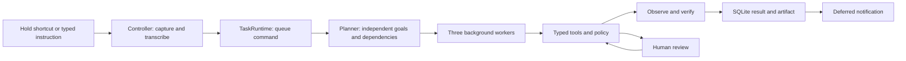

# Tasks, policy, exact input and delegation

[Documentation home](README.md) · [Capability status](CAPABILITY_STATUS.md) · [Full specification](CAPABILITY_SPEC.md)

This build replaces the production single-request execution path with a persistent task queue. It is a capability foundation, not a completed implementation of all 138 specification rows. Account authentication, physical acceptance and several broader capabilities remain pending in the status matrix.

## Execution path

The controller becomes idle once it queues a request. Another request can be recorded while earlier work runs. Three workers execute concurrently; additional work waits. A dependency waits without occupying a worker. A provider call already in flight may finish before cooperative pause/cancellation is observed. External processes have explicit cleanup; completed effects are never undone by cancellation.

`task_status` and local control phrases read the database rather than relying on the model's memory. Task Center, available from the tray, displays tasks, steps, results, history, approvals and audit records. Notifications wait while recording, holding the chord, speaking a reply or reviewing an approval. Routine completion speech is short; informational answers can be spoken in full.

## Durable state

`task_store.py` shares `data/assistant.sqlite3` with the existing preferences/approval store. New tables hold tasks, steps, artifacts, conversation history, profiles, contacts, settings, schedules, snippets, tool approvals and audit events. Artifact search uses SQLite FTS5. Artifacts contain text, not screenshot frames.

Active jobs become interrupted after a restart; they are not silently replayed. Paused work continues at a cooperative boundary in the same process. Restarting a task with recorded effects requires inspection. A reviewed deterministic plan can be reconstructed when it contains no expired local literal slots. A pasted secret is intentionally not recoverable after exit: enter it again for a fresh review.

Schedules persist and are checked once a second while Bilal runs. They resume when the startup app runs again. Missed repeated times collapse into one due run, not a flood. Scheduled actions still encounter the same tool policy. This is an in-app scheduler, not a Windows service that runs while the laptop is asleep or Bilal is closed.

## Policy and approvals

Every production model tool call enters `AgentToolExecutor.execute` and `PolicyGate.decide`. Registered metadata defines risk, mutation, idempotence and relevant path fields. Unknown tools fail closed. Reads from pages, files and windows are untrusted; subsequent mutations require review. Prompt labels remain a defense layer, not proof that every injection attack is solved.

File writes, moves, recycling and restoration require review. Folder access is checked again by `FileTools`; traversal and resolved paths outside selected roots are denied. Known private directories and credential files are excluded from model reads. Existing files have encrypted Windows DPAPI snapshots before replacement. Write/copy checks compare bytes or hashes. Recycle uses the Windows Recycle Bin.

An approval binds the task ID and exact call arguments with a digest, expires after ten minutes and is consumed atomically. L3 requires typing `CONFIRM`. There is no model-exposed approve function. Existing Gmail send, preference and power cards also record a trusted human decision; their original digest and one-shot checks remain in place.

`propose_plan` submits up to twenty deterministic file/contact/project/schedule calls in one approval. No step executes first. The executor stops at the first failed verification and does not replay earlier writes. Dynamic DOM/UI control IDs are deliberately excluded from batches. Editing a pending deterministic plan invalidates the old approval and requires a fresh review. Single-step approvals execute only that reviewed step; they do not replay the original model conversation.

The audit is append-only through SQLite triggers and uses a hash chain. It is inspectable and verifies accidental/ordinary tampering; someone who controls the database file and application code can replace it. It is not an external immutable ledger.

## Exact input

Double-clicking the avatar opens Quick Input. Instructions and pasted payloads have separate fields. Typing in the payload field immediately makes a local slot available to a subsequent voice instruction; pressing Add keeps several labeled slots. Typed-only instructions use the same runtime.

`LiteralVault` keeps exact strings and gives the planner only labels, lengths and opaque tokens. Each queued task takes its own snapshot. Tool arguments are substituted locally just before execution. Results are masked again before entering model context or logs. Known key/token formats and Luhn-valid card numbers are detected; an explicit Secret checkbox covers values that cannot be recognized reliably.

Secret slots stay in RAM. They are excluded from snippet history, task storage and model prompts. A secret cannot become a preference, contact note, project profile or scheduled goal. Supported local uses require review. Connectors currently refuse secret payloads even after approval; cloud-secret transmission is not implemented. Non-secret snippets and generated drafts/answers can be stored locally. File byte preservation is tested; this does not establish byte preservation for every app's rich-text or MIME normalization.

## Providers and external agents

`provider_interfaces.py` defines transcriber, speaker and planner interfaces. Groq implements transcription and Gemini implements planning. Reasoning still uses `AgentBrain`'s Gemini implementation; full provider interchangeability is not finished. API keys prefer process environment, then Windows Credential Manager, then the legacy private `.env`. Settings can migrate legacy keys after encrypted read-back verification.

`delegation.py` invokes fixed argument arrays without a shell. Codex runs in a read-only sandbox with user configuration/rules and the listed execution/customization features disabled. It receives the task and an explicitly chosen non-secret artifact verbatim. JSON events yield its final message, session ID and usage. Claude uses the official CLI's bare/restricted headless mode with built-in and MCP tools removed and needs its own Anthropic API key. Neither adapter exposes project write access.

The real Codex prompt/answer path passed a native smoke check. Claude installation and flags were checked; live Claude remains blocked by its missing key. The read-only sandbox is not an OS guarantee that the process cannot read any other user file. Full project-only isolation, reviewed external-agent writes, cross-agent end-to-end handoffs and spend accounting remain incomplete.

Current CLI references checked during implementation: [Codex non-interactive mode](https://developers.openai.com/codex/noninteractive), [Claude CLI reference](https://code.claude.com/docs/en/cli-reference), [Claude headless mode](https://code.claude.com/docs/en/headless).

## Browser and screen boundaries

Owned Chrome runs in a separate profile through `dom_worker.py`, not the user's personal browser profile. DOM element handles are observed, checked for changes, then invalidated after a mutation. Explicit domain settings restrict navigation/resources; private/local URLs are blocked. Generic authentication, publishing, purchasing and destructive controls are excluded. A click that returns `verified:false` is not a completed goal.

Screen questions are separate from action execution. `request_screen_view` asks the user to select a window, monitor, full desktop or pointer region. The visible indicator appears before capture. Sensitive overlapping windows block capture. Frames stay in memory for a single vision task, with a twenty-question daily cap. The screen answer model has no tools. UIA grounding is attempted; local OCR is not connected.

Pointer mode uses a lightly tinted input-intercepting overlay. Presses/releases go to that overlay and are not forwarded; after release it hides and captures the selected point or region. Automated Qt tests check event consumption. Real Windows interception, twenty-element accuracy, mixed DPI, exclusive full-screen and elevated-window behavior still need field acceptance. The implementation intentionally does not claim that those physical tests passed.
